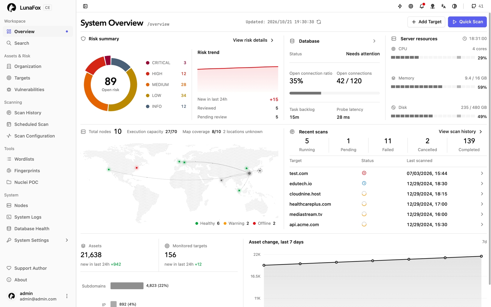
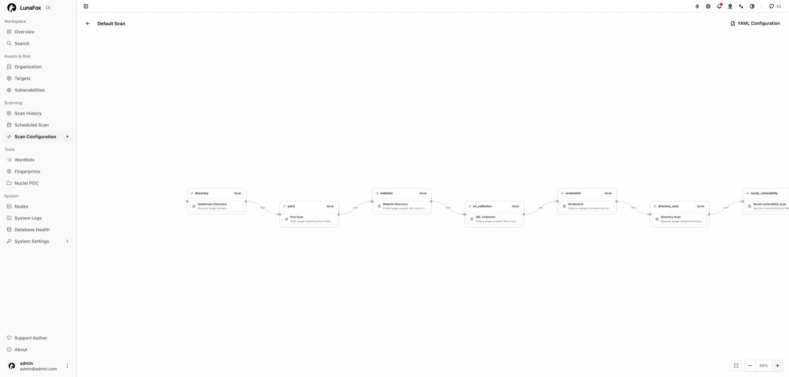
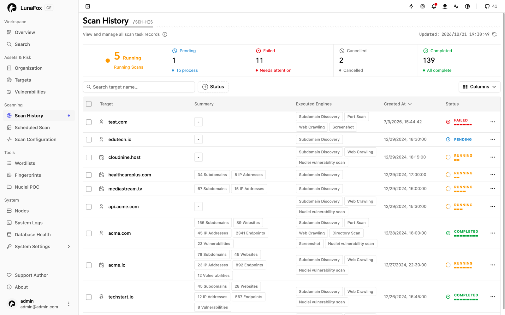
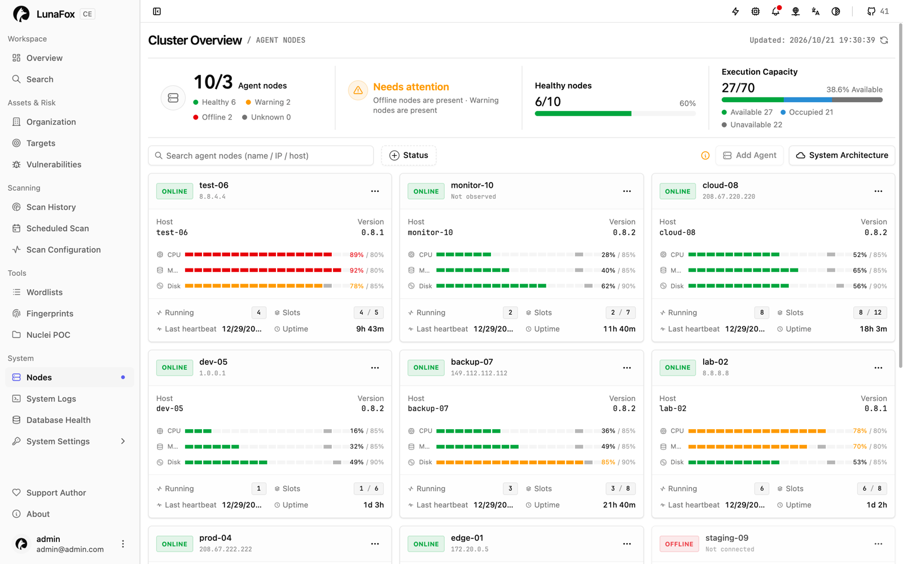

# LunaFox

**English** | [简体中文](README.md)

LunaFox is an attack surface management platform that runs asset discovery and vulnerability scans through distributed Agents (resident execution components on scan nodes) and keeps the resulting assets and findings in one web UI. The [public demo](https://lunafox-demo.vercel.app) shows the interface with sample data and requires no login.



## Capabilities

- **Attack surface inventory:** targets, subdomains, websites, endpoints, directories, and the assets discovered from them.
- **Scan orchestration:** Workflow Profiles compose ordered steps; each Scan freezes its workflow, configuration, Engine Packages, and execution plan.
- **Distributed execution:** an Agent claims an immutable plan, materializes inputs, and runs each step in an Engine container.
- **Vulnerability management:** scan results, vulnerabilities, and asset context in one place.
- **Unified UI:** overview, global asset search, wordlists and fingerprints, the Nuclei POC catalog, notifications, and in-app system upgrades.
- **MCP integration:** connect AI clients through the Model Context Protocol to deployment-wide investigation queries plus constrained target and scan actions, using a static MCP key.
- **Self-hosted control:** the control plane, PostgreSQL, Redis, UI, and a resident Agent run from one Compose stack; more Agents can join the same Server.

| Scan workflows | Scan history |
| --- | --- |
|  |  |



## Quick start

### Requirements

- Docker Engine with Linux container support and Docker Compose 2.24.0 or newer.
- A free host port for `PUBLIC_PORT`; the default is 443.
- Outbound access to Docker Hub, GHCR, or the configured registries.
- Disk space for images, database data, scan results, and retained logs.

### Install

The public repository and every `lunafox-<version>.zip` release contain equivalent deployment snapshots. Keep the deployment directory: `.env` belongs to the installation, and relative resource paths resolve from it.

**Option 1 - from the public repository**

```console
git clone https://github.com/yyhuni/lunafox.git
cd lunafox
./install.sh
```

**Option 2 - from a release archive**

```console
unzip lunafox-<version>.zip -d lunafox-<version>
cd lunafox-<version>
./install.sh
```

**Option 3 - direct Docker Compose**

```console
docker compose up -d
```

The repository and archive options both run the installer, which validates its arguments, starts the stack, and reports success only after initialization tasks, core service health, the Agent, and the public HTTPS endpoint are ready. Direct Compose skips the installer's image preheat and readiness checks; use it only when you manage those steps yourself.

For a deployment reachable from other machines, set the public address and port:

```console
./install.sh --public-host luna.example.com --public-port 8443
```

The first start creates a self-signed certificate for `PUBLIC_HOST`; this release does not manage certificates automatically.

### Sign in

Open the URL derived from `PUBLIC_HOST` and `PUBLIC_PORT` (default: the local HTTPS entrypoint) with the default administrator account:

| Username | Password |
| --- | --- |
| `admin` | `admin` |

Change the password in account settings after the first sign-in. If the administrator password is lost, run this command from the deployment directory:

```console
docker compose exec server resetadmin
```

### Run your first scan

1. Add a target or import subdomains, websites, endpoints, and directories on the Targets page.
2. Start a Quick Scan, or run a Workflow-driven Scan that composes ordered steps.
3. Watch progress and typed results arrive from the Agent and each Engine container.

## Operating the stack

Four lifecycle scripts cover the common cases; restart, logs, uninstall, and their recovery behavior are documented in the deployment guide.

| Script | Underlying command | What the wrapper adds |
| --- | --- | --- |
| `./install.sh` | `docker compose up -d` | Validates public host and port, pulls and preheats images, waits for readiness. |
| `./start.sh` | `docker compose up -d` | Starts an existing deployment and waits for readiness. |
| `./stop.sh` | `docker compose stop` | Stops resident services and keeps all data. |
| `./status.sh` | `docker compose ps` | Prints a readiness summary; exits 0 only when the deployment is fully ready. |

### Configure

Review `.env` before the first start. First-party images default to Docker Hub; select GHCR explicitly when needed:

```dotenv
RELEASE_REGISTRY=docker.io
# RELEASE_REGISTRY=ghcr.io
```

The [database environment variables](docs/public-deployment.md#database-environment-variables) section lists every database setting and its default. After the first successful start, `DATABASE_MODE`, `DB_PASSWORD`, and `JWT_SECRET` are persisted in `lunafox_config`; changing them to a different non-empty value fails fast, while empty inputs reuse the persisted values. See [configuration changes after the first start](docs/public-deployment.md#configuration-changes-after-first-start).

### Upgrade and recovery

An administrator checks, confirms, and starts eligible updates from the web UI. There is no host update script, and lifecycle scripts do not bypass the upgrade state machine. A release that declares a database migration is not eligible for the in-app upgrader yet: replace the package through the manual fallback in the deployment guide and complete the migration there. This single-node release does not provide automatic backup, preserve-data rollback, or cross-node recovery; recovery requires a verified backup restore or an approved forward fix. See [system updates](docs/public-deployment.md).

## Troubleshooting

- Readiness times out: run `./status.sh` and `./logs.sh <service>`; nothing is rolled back, so fix the cause and repeat the same command.
- Image pull or preheat fails: check outbound access to the selected registry and the engine-preheater log, then retry.
- The browser warns about the certificate: the first start uses a self-signed certificate; this release does not manage certificates automatically.
- The host port is busy: set a different `PUBLIC_PORT` before the first start, or free the port.
- Database credentials conflict after an edit: restore the original `DB_PASSWORD` and `JWT_SECRET`, or clear them so empty inputs reuse the persisted values.
- An upgrade ends in recovery or attention: follow the upgrade journal in `lunafox_upgrade_state`; there is no automatic rollback.

More recovery paths are in the [deployment guide](docs/public-deployment.md).

## Security and boundaries

- The default TLS certificate is self-signed; this release does not manage certificates automatically.
- This single-node deployment does not provide rolling upgrade, automatic backup, preserve-data rollback, or cross-node recovery.
- Agent authentication uses a long-lived bearer credential. Agent TLS identity, replay protection, rotation, and revocation are deferred and require a separate security change.
- Run LunaFox only on infrastructure you own or control.

## Documentation

- [Public deployment guide](docs/public-deployment.md): installation, lifecycle, database settings, upgrades, logs, certificates, and recovery.
- [Release notes](release-notes/README.md): changes in each release.

## License and contributing

Deployment files and first-party public Runtime and Engine source are `GPL-3.0-only`; Engine Runtime Images and Engine Packages are public artifacts. Third-party components keep their own licenses and attribution terms. The full text is in [LICENSE](LICENSE).

> **GENERATED / READ-ONLY PROJECTION.** Generated from the private LunaFox source; report defects against the matching release tag via [CONTRIBUTING.md](CONTRIBUTING.md).
