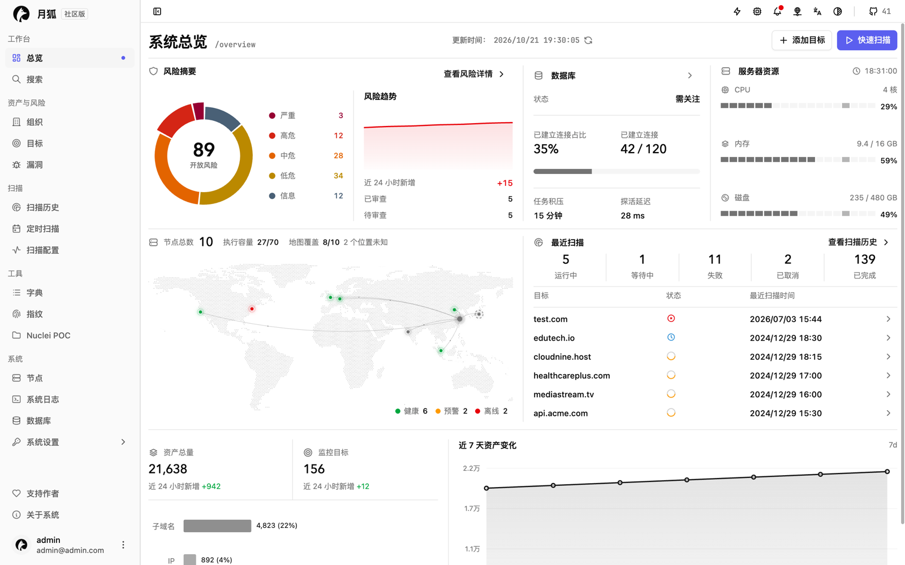
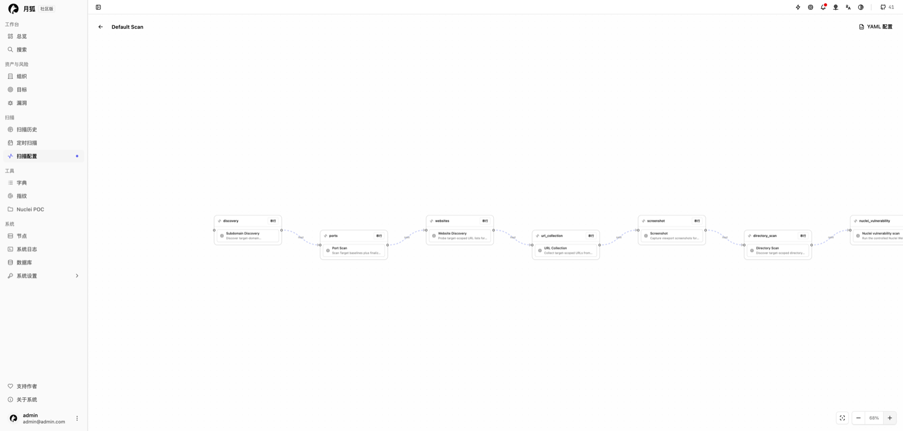
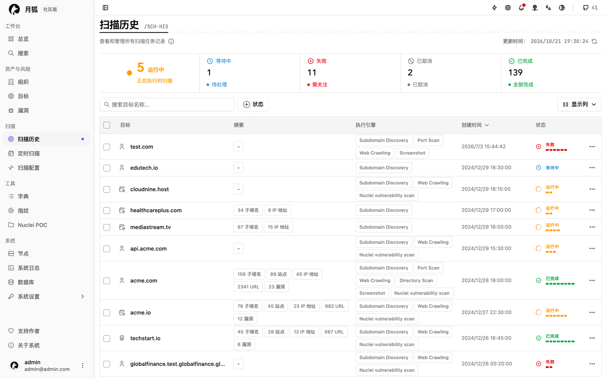
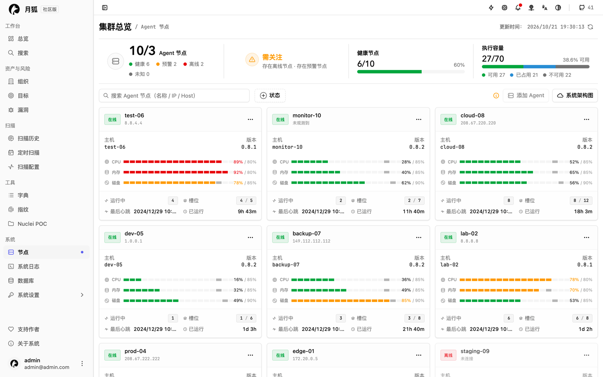

# LunaFox

**简体中文** | [English](README.en.md)

LunaFox 攻击面管理平台，通过分布式 Agent（部署在扫描节点上的常驻执行组件）执行资产发现与漏洞扫描，并把资产和漏洞结果集中在一个 Web 界面里。[公开演示站](https://lunafox-demo.vercel.app) 用示例数据展示界面，无需登录。



## 核心能力

- **资产盘点：** 目标、子域名、网站、端点、目录，以及由它们发现的资产。
- **扫描编排：** 工作流把扫描步骤按顺序组合；每次扫描都会固定当时的工作流、配置、引擎包和执行计划。
- **分布式执行：** Agent 领取不可变的执行计划，准备好输入文件，再在引擎容器里逐步执行。
- **漏洞管理：** 扫描结果、漏洞和资产信息集中在一处。
- **统一界面：** 总览、全局资产搜索、字典与指纹、Nuclei POC、通知，以及应用内系统升级。
- **MCP 集成：** 通过 Model Context Protocol 把 AI 客户端接入部署范围的调查查询，以及受控的目标与扫描操作，使用静态 MCP 密钥。
- **自托管：** 控制面、PostgreSQL、Redis、界面和常驻 Agent 都跑在同一套 Compose 里，之后还可以接入更多 Agent 节点。

| 扫描工作流 | 扫描历史 |
| --- | --- |
|  |  |



## 快速开始

### 环境要求

- 支持 Linux 容器的 Docker Engine，以及 Docker Compose 2.24.0 或更高版本。
- 为 `PUBLIC_PORT` 准备一个可用端口；默认是 443。
- 能访问 Docker Hub、GHCR 或已配置的镜像仓库。
- 为镜像、数据库数据、扫描结果和保留的日志预留磁盘空间。

### 安装

公共仓库和每个 `lunafox-<version>.zip` Release 都包含等价的部署快照。请保留部署目录：`.env` 归安装实例所有，相对资源路径也从这个目录解析。

**方式 1：从公共仓库安装**

```console
git clone https://github.com/yyhuni/lunafox.git
cd lunafox
./install.sh
```

**方式 2：从 Release 压缩包安装**

```console
unzip lunafox-<version>.zip -d lunafox-<version>
cd lunafox-<version>
./install.sh
```

**方式 3：直接使用 Docker Compose**

```console
docker compose up -d
```

仓库和压缩包两种方式都会运行安装脚本，它会校验参数、启动整套服务，只有初始化任务、核心服务、Agent 和公共 HTTPS 入口全部就绪后才报告成功。直接使用 Compose 会跳过安装脚本的镜像预热和就绪检查，只建议在自行处理这些步骤时使用。

如果部署要从其他机器访问，请设置公网地址和端口：

```console
./install.sh --public-host luna.example.com --public-port 8443
```

首次启动会为 `PUBLIC_HOST` 生成自签名证书；本版本不提供自动证书管理。

### 登录

打开由 `PUBLIC_HOST` 和 `PUBLIC_PORT` 得到的地址（默认：本机 HTTPS 入口），用默认管理员账号登录：

| 用户名 | 密码 |
| --- | --- |
| `admin` | `admin` |

首次登录后请在账号设置里修改密码。如果忘记管理员密码，在部署目录中运行：

```console
docker compose exec server resetadmin
```

### 发起第一次扫描

1. 在“目标”页面添加目标，或导入子域名、网站、端点和目录。
2. 发起快速扫描，或运行由有序步骤组成的工作流扫描。
3. 查看 Agent 和每个引擎容器回传的进度和结构化结果。

## 日常运维

四个生命周期脚本覆盖常用操作；restart、logs、uninstall 以及各自的恢复行为请见部署指南。

| 脚本 | 底层命令 | 封装脚本额外完成的工作 |
| --- | --- | --- |
| `./install.sh` | `docker compose up -d` | 校验公网地址和端口，拉取并预热镜像，等待就绪。 |
| `./start.sh` | `docker compose up -d` | 启动已有部署，等待就绪。 |
| `./stop.sh` | `docker compose stop` | 停止常驻服务，保留全部数据。 |
| `./status.sh` | `docker compose ps` | 输出就绪摘要；完全就绪时才返回 0。 |

### 配置

首次启动前检查 `.env`。第一方镜像默认从 Docker Hub 拉取；需要时显式改用 GHCR：

```dotenv
RELEASE_REGISTRY=docker.io
# RELEASE_REGISTRY=ghcr.io
```

[数据库环境变量](docs/public-deployment.zh-CN.md#数据库环境变量)一节列出所有数据库设置和默认值。首次成功启动后，`DATABASE_MODE`、`DB_PASSWORD` 和 `JWT_SECRET` 会记到 `lunafox_config`；再改成不同的非空值会直接失败，留空则复用已保存的值。恢复步骤见[首次启动后的配置变更](docs/public-deployment.zh-CN.md#首次启动后的配置变更)。

### 升级与恢复

升级是产品自带的功能：管理员在 Web 界面里检查、确认并启动符合条件的更新。没有宿主机升级脚本，生命周期脚本也不会绕过升级流程。含数据库迁移的 release 目前无法在应用内自动升级：更新仍会显示，但需要按部署指南的手动 fallback 替换发布包并完成迁移。这个单机版本不提供自动备份、保留数据的回滚或跨节点恢复；出问题只能靠已验证的备份恢复，或走批准过的前向修复。详见[系统更新](docs/public-deployment.zh-CN.md)。

## 故障排查

- 就绪超时：运行 `./status.sh` 和 `./logs.sh <service>`；不会自动回滚，请先修复再重复同一条命令。
- 镜像拉取或预热失败：检查到所选仓库的出站网络，以及 engine-preheater 的日志，然后重试。
- 浏览器提示证书问题：首次启动使用自签名证书；本版本不提供自动证书管理。
- 宿主机端口被占用：首次启动前改一个不同的 `PUBLIC_PORT`，或释放该端口。
- 修改后数据库凭据冲突：恢复原来的 `DB_PASSWORD` 和 `JWT_SECRET`，或清空它们让空输入复用已保存的值。
- 升级进入恢复或需要关注的状态：以 `lunafox_upgrade_state` 里的升级日志为准；没有自动回滚。

更多恢复路径见[部署指南](docs/public-deployment.zh-CN.md)。

## 安全边界

- 默认 TLS 证书是自签名的；本版本不提供自动证书管理。
- 这个单机部署不提供滚动升级、自动备份、保留数据的回滚或跨节点恢复。
- Agent 目前通过长期有效的 bearer 令牌认证。Agent 侧的 TLS 证书身份校验、重放保护、令牌轮换和吊销尚未实现，这些需要另行做安全加固。
- 请在自有或受控的基础设施上运行 LunaFox。

## 文档

- [公共部署指南](docs/public-deployment.zh-CN.md)：安装、日常运维、数据库设置、升级、日志、证书与恢复的完整说明。
- [Release Notes](release-notes/README.md)：每个版本的变更记录。

## 许可与贡献

部署文件和第一方公开的 Runtime 与 Engine 源码使用 `GPL-3.0-only` 许可；Engine Runtime Images 和 Engine Packages 是公开产物。第三方组件继续遵循各自的许可证和署名条款。完整许可文本见 [LICENSE](LICENSE)。

> **GENERATED / READ-ONLY PROJECTION（生成投影，只读）。** 由 LunaFox 私有源码生成；发现问题请带上对应 release tag 按 [CONTRIBUTING.md](CONTRIBUTING.md) 反馈。
